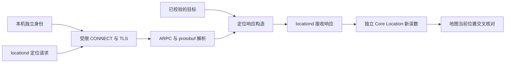

# 定位修改功能规范

本文件规定 LocationBridge `0.1.0` 已实现功能、操作约束和验收标准。它是修改定位功能的统一入口；操作步骤见[操作手册](operations.md)，实机支持范围见[兼容矩阵](compatibility.md)。实现发生变化时，代码、测试、本文件和操作手册必须同时更新。

“必须”和“禁止”是维护规则；“当前实现”描述现有代码。“未实现”不得写成已经提供的能力。本文件不包含任何使用者的真实地址、目标坐标、证书、代理配置或运行日志。

## 1. 功能范围

| 编号 | 功能 | 规则与边界 |
|---|---|---|
| F01 | 设置目标 | 输入 WGS84 纬度、经度；App 不直接解析住宅地址，也不表达楼层、房间或单元号。地址转坐标必须另行核实来源 |
| F02 | 构造定位响应 | 基于本次 Apple Wi-Fi 定位请求的设备条目生成目标位置响应；保留兼容所需的未知 protobuf 字段，不提供任意上游代理 |
| F03 | 本机身份 | 每台设备显式生成自己的身份和随机密码；项目不分发可共用的私钥 |
| F04 | 信任实验 | 仅为指定叶证书、当前 `locationd` 指定签名要求、两个精确 SSL 主机设置实验约束 |
| F05 | 兼容预检 | 只读检查身份、离线 SSL 策略和精确信任范围；不写系统信任，不宣称已验证实际位置 |
| F06 | 本地服务 | 显式启动、停止；只监听 loopback，收到就绪回执后才能显示正在监听 |
| F07 | 网络接入 | 当前提供独立的 Surge 脚本；App 不自动安装、改写或撤销 Surge 配置 |
| F08 | 实际位置读取 | 独立使用 Core Location 读取本次请求后的有效读数；目标输入、服务状态与实际读数分开展示 |
| F09 | 状态与诊断 | 输出受限的结构化状态和计数，不记录原始 Wi-Fi 请求、目标坐标或密码到常规诊断 |
| F10 | 恢复 | 分别恢复网络、停止服务、移除本会话实验信任；遇到外部变更拒绝覆盖 |
| F11 | 版本与发布 | 构建、CI、安装、真实定位、重启持续性分别验收；支持结论必须限定到实测系统/build |

公网 IP、系统地区、时区、账号国家、其他设备的定位和浏览器脚本模拟不属于这些功能。不能把 IP 出口或地图手动搜索结果作为系统定位修改成功的证据。

## 2. 模块职责和数据流

| 模块 | 职责 | 不承担的职责 |
|---|---|---|
| `LocationBridgeCore` | 校验目标、解析 CONNECT/HTTP/ARPC/protobuf、TLS 服务、资源生命周期与计数 | 系统信任写入、代理配置、界面权限 |
| `location-bridge` | CLI 参数、身份生成、只读预检、显式调用信任 helper、服务与独立探测 | 自动配置网络、自动刷新系统定位缓存 |
| `locationbridge-trust` | 精确快照、设置范围检查、显式实验写入与删除 | 给根证书全局授信、修改 SIP 或绑定数据库 |
| `LocationBridge` App | 输入、子进程管理、预检门禁、恢复句柄和原生位置展示 | 从保存的目标推导实际读数、自动证明地图结果 |
| Surge 集成脚本 | 对指定 profile 增减本项目所属条目，保留私有 before-state | 替换整份历史配置、修改全局出口和 DNS |

该图描述调用链，不代表任一前序步骤成功就能推定后续步骤成功。

## 3. 目标输入与修改

- 纬度必须有限且位于 `[-90, 90]`，经度必须有限且位于 `[-180, 180]`；拒绝 `NaN`、无穷大和无法解析的输入。
- Core 的水平和垂直精度必须大于 `0` 且不超过 `1,000,000` 米；高度必须有限，范围为 `[-12,000, 1,000,000]` 米。
- Core 默认水平精度 `10` 米、垂直精度 `10` 米、高度 `0`；这些是响应参数，不是设备最后报告精度的保证。
- App 当前只提供经纬度输入，启动服务使用默认精度；CLI `serve --accuracy` 可指定水平精度。Core 的高度、垂直精度和 `setTarget` 是库接口，不是现有 App/CLI 的全部交互选项。
- App 初始坐标为空，坐标仅保留于本次界面会话，不自动保存、开机恢复或重新锁定。
- App 最后选择的身份路径也不持久保存，重新打开会回到默认 `Identity`；恢复句柄单独保存，不能由它推定当前身份目录已自动切换。
- App 服务运行时禁止编辑目标；修改目标须先停止服务，再编辑并重新启动。CLI 须重新启动 `serve`。不能宣称 App 已提供运行中热更新。
- 编辑输入后，既有实际位置展示会提示需要重新读取。输入新的目标本身不改变实际位置。

读取正在进行时编辑目标不会中止探测，距离按接收读数时输入框内的目标计算；要验收一个固定目标，探测期间应保持输入不变。

## 4. 身份生成与保存

默认目录为 `~/Library/Application Support/LocationBridge/Identity`，生成后仅保留：

| 文件 | 内容 |
|---|---|
| `identity.p12` | 本机叶证书、私钥及证书链 |
| `password.txt` | 本机随机导出密码；这是文件权限保护的本地文件，不是钥匙串密码存储 |
| `leaf.pem` | 叶证书公共部分 |
| `root.pem` | 根证书公共部分 |

- 生成采用系统 OpenSSL、RSA 2048、SHA-256；根有效期为 `365` 天，叶有效期为 `90` 天。SAN 仅含本规范第 7 节的两个主机。
- 密码来自 `SecRandomCopyBytes` 的 32 字节随机数据；传给 OpenSSL 时使用子进程环境，不放入命令行参数或回执。
- 生成目录 `0700`、四个保留文件 `0600`。明文根/叶私钥、CSR、临时配置和序列号文件在完成后移除；后续使用私钥位于 P12 中。
- CLI 拒绝任何已经存在的最终目标，包括最终目标为符号链接；不覆盖旧身份。App 遇到现有目录时选择新的独立目录。
- App 禁止选择 Git 检出内的身份目录；CLI 生成器当前没有等价的完整 Git/父链约束，操作者仍必须把身份放在 Git 外。
- 导入已有身份与生成身份是两种情形：当前 P12 loader 不保证全面检查外来目录的 `0600/0700` 权限、父链和 SAN。不能将生成路径的保证扩大到所有导入文件。
- 当前 P12 loader 要求 file URL，文件大小为 `1–4,194,304` 字节，且 `SecPKCS12Import` 只返回一个可用 identity；这些检查不能替代导入目录和证书用途的全面审核。
- P12 服务仅在 macOS 15+ 使用内存限定导入；13/14 明确拒绝这一启动路径。不得改回静默持久导入钥匙串。
- 证书到期必须显式更换身份和信任会话，不覆盖已存在目录，不使用忽略到期校验作为续期方案。

## 5. 受限信任的安装、检查与移除

### 5.1 固定范围

最终实验配置固定为：管理员信任域、当前叶证书、SSL 服务端策略、两个精确主机、实际 `/usr/libexec/locationd` 的指定签名要求、`TrustAsRoot=2`、`AllowedError=0`。

`AllowedError=0` 是未公开保证的兼容行为，可能覆盖上述约束内其他未映射的可恢复校验错误，不能描述为“仅忽略四个错误”或 Apple 支持的永久接口。App 签名、TLS 身份、信任范围和系统实际接受结果是不同对象。

禁止将范围扩大为任意应用、通配主机、全局根信任或 System 信任域。禁止修改 SIP、Apple 系统二进制、证书绑定数据库及无关信任项。

### 5.2 快照与应用

1. `prepare-trust` 必须先完成快照；叶证书在 user/admin 任一域已有设置时拒绝覆盖。
2. 快照包括叶/根公共 DER、原缺省状态、OS/build、locationd 原指定签名要求及约束参数；不包括私钥和代理 profile。
3. CLI 为信任会话创建私有父目录，拒绝 Git 检出或符号链接父链，父目录需无组/其他用户访问权限；新会话目录 `0700`、快照文件 `0600`。
4. App 必须在调用 apply 前保存 `activeTrustSessionPath` 恢复句柄；已有句柄时，先处理旧会话，再安装另一身份。
5. apply 前重新核对缺省状态、OS/build、locationd 签名要求；不满足时拒绝。
6. 系统认证由 macOS 处理。密码不得进入聊天、源码、日志或程序参数。配置写入后必须检查实际回读。

App 安装按钮先显示明确说明并由使用者选择。CLI 的 `apply-trust` / `restore-trust` 本身是显式变更命令，会自动给 raw helper 传确认标识；CLI 没有另一个必须手工填写的 `--confirm` 选项。不能把 raw helper 的参数要求误写为 CLI 交互。

### 5.3 所有权与恢复

- 正常设置必须精确匹配两条约束；SDK 回读增加的 SSL policyName 仅接受预期值。
- `trust-status` 只报告 `baseline_absent` 或本会话约束存在；冲突、未知字段/范围、错误快照参数或不匹配的签名约束均拒绝当成自己所有。
- restore 只删除该叶证书的精确所属记录，不导入整域备份，不调用 Set(NULL) 形成空缺省授信。
- restore 使用快照中的旧约束识别所有权，不要求当前 OS 或 locationd 仍与旧版本相同，以便升级后清理自己的旧记录。
- 外部漂移必须保留现场并报告，不能删除他人条目或靠扩大匹配范围“修复恢复”。已缺省时可确认原始状态，不应解释成重新安装。
- 当前 helper 的 `systemTrustChanged` 是变更命令分类回执，不能独立证明发生了实际差异；应结合前后 state 与系统回读判断。

## 6. 兼容预检与界面门禁

成功生成的预检报告包含 `osVersion`、`buildVersion`、`identityPresent`、`pinningAssessmentWithExplicitAnchor`、`locationdScopedTrustPresent`、`systemLocationVerified=false` 和评估范围说明。身份齐备且评估完成时有两个主机条目；身份文件缺失时数组为空并退出 `2`。畸形文件或其他读取/解析错误可退出 `1`，不能承诺每次都返回完整 JSON 或两个评估结果。

当前预检允许继续实验的条件为：身份存在，且精确 scoped 设置匹配，或者两个主机在调用者显式锚点评估中均接受。精确 scoped 检查通过不代表另一个调用者的离线 SSL 一定通过；调用者身份不同，结果不能互相替代。

- App 只有在 CLI 退出 `0` 且报告满足完整门禁时启用启动按钮；切换身份、安装或移除信任会使预检失效。
- App 不在每次启动服务时自动重验，也不持续监听外部信任、身份或 OS 漂移。编辑坐标、停止服务或仅读取信任状态不会清除旧预检；外部环境变化后必须主动重跑。
- 当前 Core / CLI `serve` 不强制先运行预检；这是操作者接口，标准操作仍必须先预检，不能把手工启动解释为系统兼容已通过。
- 预检不修改信任或网络，也不对其他设备、后续 build、休眠和重启作成功承诺。

## 7. 网络与协议边界

| 项目 | 当前默认与规则 |
|---|---|
| 监听地址 | 仅 IPv4 `127.0.0.1`，默认端口 `19443` |
| CONNECT 主机 | 仅 `gs-loc.apple.com`、`gs-loc-cn.apple.com`，仅目标端口 `443` |
| HTTPS 方法/路径 | `POST /clls/wloc`，允许该路径的 query；Host 必须与 CONNECT 主机一致 |
| HTTP 版本 | 解析 HTTP/1.0、HTTP/1.1；没有 HTTP/2、HTTP/3 或通用隧道实现 |
| framing | 明确且唯一的 Content-Length；正文必须大于 0；拒绝重复头、折叠头、Transfer-Encoding、Expect 和非 identity 的 Content-Encoding |
| 头部上限 | 默认 `32,768` 字节；Core 配置范围 `1,024–65,536` 字节 |
| 请求体上限 | 默认 `1,048,576` 字节；Core 配置范围 `1–1,048,576` 字节 |
| 并发客户端 | 默认 `8`；Core 允许 `1–64`，超限关闭，不形成无界等待队列 |
| 请求时间配置 | 默认 `10` 秒；Core 允许 `1–30` 秒。使用 socket 超时与阶段 deadline；不是跨所有底层阻塞操作的硬实时总时限保证 |
| 响应 | 校验 ARPC/protobuf，拒绝空 Wi-Fi 列表和无法支持的 payload；只对本次条目生成位置，不记录原始正文 |
| fd 所有权 | 原生 socket 单一所有者；CFStream 只借用，错误与关闭路径不得重复 close 已复用的 fd |

Core 配置的端口范围是 `1024–65535`；App 当前固定 `19443`。不要把 Core 中可配置的并发、超时、头部/正文上限误写为现有 CLI/App 的全部可调参数。

服务没有 peer PID 校验或客户端证书鉴权，也未检查 TLS SNI。`locationd` 的进程限制来自外部规则和信任设置，不是 Core 对所有本机 TCP 客户端的身份认证。

响应使用固定 8 字节前缀、2 字节大端长度及最多 `65,535` 字节 protobuf；坐标乘 `10⁸` 后取整，精度和海拔也按 wire 类型取整。清除请求侧 numCell/numWifi/deviceType，保留未知 wire 字段。HTTP 成功响应的当前 Content-Type 是 `application/x-www-form-urlencoded`，完成单次请求后关闭连接。没有 keep-alive、通用 fallback 或任意上游透传。

拒绝通常通过关闭连接与计数呈现；不能承诺所有错误都会得到 HTTP 400/403/413 或 JSON 错误响应。

`stop()` 取消监听并 shutdown 活跃连接，最多等待监听取消约 `2` 秒；它不 join 所有 worker。返回瞬间活跃计数可能暂未归零，不能据此立即判定恢复失败或宣称所有工作线程已结束。

## 8. Surge 接入和恢复

- 仅操作显式指定的 profile；操作者必须先确认它是当前使用的 profile，脚本不自动选择。
- 增加 `LocationBridge-Local` 本地 HTTP 代理和两条 `locationd + 精确域名` 规则，并使用所属注释标识。启动服务和配置这些规则是分开的动作。
- apply 先检查本地端口可连接，再写私有候选、调用 Surge 校验、保存 before-state，比较当前文件并替换、reload。
- restore 按当前 profile 删除精确所属条目，保留会话中其他编辑；不使用整份旧 profile 回写。
- 重复条目、错误 section、未知策略引用、端口变化或会话元数据不匹配时拒绝。
- 脚本无法对不合作的并发 writer 提供原子 CAS；操作期间避免同时编辑 profile。
- apply 在校验前可能已经创建 state 目录；失败后保留现场，选新的 state 重试。restore 使用唯一候选名，可检查后重试。
- 写入后 reload 失败属于部分完成，必须明确报告并使用同一会话恢复，不能声称完全没有修改。
- profile 内容保留不等于 inode、ACL、xattr、owner 等全部文件属性保持不变。插入当前要求精确的 `[Proxy]\n` / `[Rule]\n` 节标题，不保证所有其他合法换行/注释格式都可直接使用。

## 9. 启停、退出与权限

- 打开 App 不自动生成身份、写信任、改代理、请求定位或启动服务。
- 启动子进程不等于监听就绪；App 必须收到完整 `ready` 回执并核对地址、端口、验证字段。
- 服务运行时限制目标、身份和信任操作，避免用一个会话的数据控制另一服务。
- 普通退出或关窗在命令忙碌时被阻止；系统认证未结束时先完成或取消。强制退出不保证取消已开始的 helper 操作。
- 正常退出会停止 App 所启动的 CLI 和自身位置读取，但不自动撤销系统信任或外部 Surge 条目。
- App 当前不提供自动重启、开机启动、崩溃后的子进程自动回收、自动证书续期、恢复句柄枚举或自动清理所有历史会话。

四组状态分别是：短命令 `commandBusy`、自有服务 `serviceActive`、预检 `preflightPassed`、独立读取 `probeStartedAt`，它们不能合成一个“已应用”状态。

| 控件 | 当前启用条件 |
|---|---|
| 身份选择/生成、预检、安装信任 | 无短命令、自有服务未运行 |
| 读取/移除信任 | 上述条件，加已有恢复句柄 |
| 启动服务 | 无短命令、自有服务未运行、旧预检通过；点击时才校验目标 |
| 停止服务 | 自有服务尚未退出，包括启动和停止中的阶段 |
| 经纬度 | 自有服务未运行；不因短命令自动锁定 |
| 读取实际位置 | 没有另一轮读取；不依赖预检或服务状态 |

独立位置读取可以与短命令或服务并行。App 只保存一个恢复句柄；读取/移除以该快照为准，不一定以当前选中的身份目录为准。App 请求终止直接子进程但不保证等待全部后代退出，没有统一 watchdog 或强杀升级。

## 10. 新鲜位置与成功标准

| 层次 | 可证明的内容 | 不能替代的内容 |
|---|---|---|
| 目标通过校验 | 参数格式与范围已检查；App 在启动点击时校验，单纯输入只有文本录入 | 系统位置改变 |
| 身份/信任已准备 | 文件存在、范围匹配 | locationd TLS 接受 |
| 本地服务 ready | 指定端口监听 | 网络已经导向它 |
| TLS/HTTP 和合成响应 | 客户端进入协议且响应写出 | Core Location 已采用 |
| 新鲜 Core Location | 本次请求后的系统读数与目标比较 | 具体目标 App、室内单元或未来持续性 |
| 地图“我的位置” | 独立 App 的当前位置与目标吻合 | 重启、休眠及升级后仍可用 |

App 名义等待 `30` 秒；CLI `probe` 默认 `30` 秒、允许 `1–120` 秒。两者都要求有效坐标、有限且非负的水平精度、读数时间不早于本次请求。CLI 另要求距当前时间的绝对差小于 `5` 秒；App 当前只限制不超过当前时间未来 `2` 秒，没有 CLI 那项额外的最大年龄限制。

App 的主线程 Timer 包含权限等待，可能受模态面板和调度影响而延后，不是硬实时截止。App 取当前批次逆序首个有效结果，CLI 只看 `locations.last`；一旦接受读数就结束，不自动持续等待更接近目标的结果。

CLI 以距目标 `100` 米以内输出 `within100Meters=true`，仍保留 `mapCrossCheckVerified=false`。App 展示实际数值和四舍五入到米的距离，不自动给出完整验收通过状态。显示“0 米”不等于系统精度为 0，也不是房间级定位证明。

人工地图核对必须使用“我的位置”，记录测试系统/build、读取时间、实际精度和匹配结论；不能用搜索目标地址或预先放置的图钉替代。真实地址和坐标仅留在私有回执，公开记录只写脱敏结论。

## 11. 诊断与隐私

- `ready` 始终包含 `systemLocationVerified=false`；`counters` 仅在计数快照变化时按约 `5` 秒周期输出。
- 计数包括监听、已接受/活跃/拒绝连接、TLS 阶段失败、请求阶段失败、已解析请求和已完整写出的合成响应。它们描述处理阶段，不是精确的证书错误归因或系统采纳结果。
- App 常规诊断每行截到 `16,384` 字符，总展示保留最后 `32,768` 字符。实际位置只显示在独立结果区，不写入该诊断区。
- 真实地址、单元号、坐标、Wi-Fi 标识、请求体、证书/私钥、密码、完整代理 profile、快照和本机验收材料禁止进入公开仓库、issue、PR 或 CI 夹具。
- 当前 CLI `serve` 的本机进程参数可包含坐标和身份目录；不能宣称对本机同权限进程实现了保密隔离。身份密码不通过命令行传递。
- 公开树门禁是补充检查，不保证识别所有编码后的私人数据。公开示例使用变量或合成数据；私有词清单放在 Git 外。
- 定位实验和关联私有记忆仅由 Codex 处理，不转给 Claude/Gemini 会话、工具或记忆。

| 计数字段 | 准确定义 |
|---|---|
| `acceptedConnections` | 实际 accept 的 TCP 连接，包括随后被容量限制拒绝者 |
| `activeConnections` | 已登记且 handler 尚未清理的连接 |
| `rejectedConnections` | 未进入 TLS 前的拒绝，包括容量、socket 配置或 CONNECT 失败 |
| `tlsFailures` | CONNECT 200 写出后、完整 HTTPS 头收到前的失败，不只密码学握手错误 |
| `requestFailures` | 完整 HTTPS 头收到后的解析、正文、protobuf、响应或发送失败 |
| `parsedRequests` | 合法头和声明正文收齐，ARPC/protobuf 仍可能失败 |
| `syntheticResponses` | 完整合成响应已写出，不代表客户端或系统采纳 |

同一 Core 实例 stop/start 保留累计计数，新 CLI 进程从零开始。App 回调捕获前 `131,072` 字节输出，超长无换行 pending 会丢弃；当前没有日志导出、持久化或通用异常脱敏器，不能保证任意错误文本不含本机路径。

## 12. 修改、提交与验收门禁

任何行为变化先核实实现与调用方；高风险修改必须有失败场景、范围检查与恢复办法。不能通过增加信任范围、去掉验证或隐藏警告处理兼容失败。

| 改动 | 必查资料与验证 |
|---|---|
| 目标/协议/TLS/fd | 本规范、Core 代码、单元和真实 loopback TLS 测试 |
| 身份/信任/helper | 本规范、信任说明、快照/归属拒绝用例、只读 helper 回归；本机变更另行实测 |
| App/启动/退出 | 本规范、UI 状态、隐藏真实窗口构造、安装后的可见界面 |
| 代理/恢复 | 本规范、Surge 手册、合成 profile 回归、当前文件前后差异 |
| 系统升级适配 | 系统完整版本/build、预检、实际 locationd 链路、新鲜系统位置、独立地图与恢复边界 |
| 对外提交 | 私有内容检查、许可证与版本、Git/CI/安装/实际验收分层回执 |

验证命令和角色规则以 [AGENTS.md](../AGENTS.md)、[AI 规范](ai-coding/README.md)、[贡献指南](../CONTRIBUTING.md)为准。维护者及使用同一管理账号的授权 AI 可以直接更新 main，无额外 PR 审批；其他贡献走 fork/PR，由维护者或授权 AI 审核。不能将提交推送、CI 通过或单台成功扩大为全平台兼容。

## 13. 未实现能力与升级约束

本项目 Package 的 tools-version 语法声明为 `5.9`，不等于整套依赖可用 Swift 5.9 构建。固定的 SwiftProtobuf `1.38.1` 提供 tools-version `6.1` 的兼容 manifest 及 `6.2` 的默认 manifest；选择工具链时需满足依赖和 SDK 要求。本轮实际构建证据为兼容矩阵中的 Xcode 版本，不对所有旧工具链作构建通过承诺。

自动地址地理编码、运行中 App 热切换目标、自动网络接入/撤销、自动续证、开机持久化、无条件恢复以及跨机器/跨系统保证均未实现。新增这些能力必须另行明确契约、权限、失败恢复、测试和实际验收，不得只改文案假装已经支持。

系统不兼容时先区分协议、信任、网络、缓存和目标 App。若受限路线失效，应保留最小复现和恢复状态，重新评估方案；不得擅自改 SIP、系统文件或绑定数据库。
